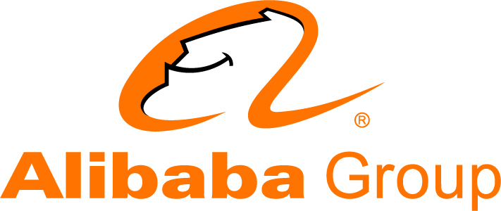
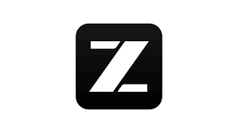
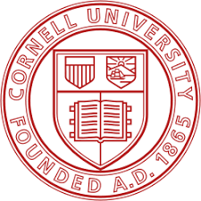

M.S. student in ECE at [Carnegie Mellon University](https://www.cmu.edu/){:target="_blank" rel="noopener noreferrer"}, graduating in January 2028.  
Seeking Summer 2027 internship opportunities in AI agents and machine learning.
  
I explore two frontiers:
- Building efficient, agentic, and multimodally intelligent models
- Designing scalable multi-agent systems for complex real-world tasks

## Interests
- AI agents, multi-agent systems, and agent infrastructure
- Multimodal AI across text, images, graphs, and voice
- RAG, data pipelines, retrieval systems, and databases
- AI for healthcare/finance, software engineering, and high-stakes domains

## Experience

  <article class="experience-list__item">
    
    

      

        

          <h3><a href="https://www.alibaba.com/" target="_blank" rel="noopener noreferrer">Alibaba Group</a></h3>
          
AI Engineering Intern

        

        
Jun. 2026 - Aug. 2026

      

      <ul>
        <li>Built an agent platform on the pricing infrastructure behind Alibaba's e-commerce ecosystem (Taobao, AliExpress, Qwen, etc.), orchestrating Q&amp;A, requirement tickets, PRD generation, and AI coding with a state-machine backend, distributed locking, and idempotent transactions.</li>
        <li>Built a knowledge flywheel that distills closed tickets into reusable QA via a LoRA-tuned Qwen model and BGE-M3 + DBSCAN clustering, continuously expanding what the agent can resolve on its own.</li>
      </ul>
    

  </article>

  <article class="experience-list__item">
    
    

      

        

          <h3><a href="https://m.shein.com/us/?cdn_rsite=cf&amp;ref=www&amp;rep=dir&amp;ret=mus" target="_blank" rel="noopener noreferrer">SHEIN</a></h3>
          
Machine Learning Engineering Intern

        

        
Mar. 2026 - Jun. 2026

      

      <ul>
        <li>Built two recall channels for SHEIN's new For You Trends tab: a two-tower retriever adapted for new-user cold start, and RQ-KMeans semantic IDs for generative retrieval over millions of trend items.</li>
        <li>Built a SWE-bench-style benchmark pipeline that mines internal Java repositories into executable tasks and tests, enabling reproducible evaluation and regression testing of coding agents and Agent Skills.</li>
      </ul>
    

  </article>

  <article class="experience-list__item">
    
    

      

        

          <h3><a href="https://huggingface.co/zai-org" target="_blank" rel="noopener noreferrer">Z.ai</a></h3>
          
Software Engineer Intern

        

        
Dec. 2025 - Mar. 2026

      

      <ul>
        <li>Architected an agent harness and testing automation workflows for Mercedes-Benz QNX software testing.</li>
      </ul>
    

  </article>

  <article class="experience-list__item">
    
    

      

        

          <h3><a href="https://www.gatech.edu/" target="_blank" rel="noopener noreferrer">Georgia Institute of Technology</a></h3>
          
Research Assistant

          
Advisor: Prof. <a href="https://www.cc.gatech.edu/people/munmun-de-choudhury" target="_blank" rel="noopener noreferrer">Munmun De Choudhury</a>

        

        
Aug. 2025 - Dec. 2025

      

      <ul>
        <li>Designed mental health agent frameworks for transparent, role-bounded clinical support.</li>
      </ul>
    

  </article>

  <article class="experience-list__item">
    
    

      

        

          <h3><a href="https://www.cornell.edu/" target="_blank" rel="noopener noreferrer">Cornell University</a></h3>
          
Research Assistant

          
Advisors: Prof. <a href="https://www.duffield.cornell.edu/people/mert-sabuncu/" target="_blank" rel="noopener noreferrer">Mert Sabuncu</a> and <a href="https://ddrrnn123.github.io/" target="_blank" rel="noopener noreferrer">Ruining Deng</a>

          
Repo: <a href="https://github.com/ddrrnn123/glo-vlms" target="_blank" rel="noopener noreferrer">glo-vlms</a>

        

        
Mar. 2025 - Present

      

      <ul>
        <li>Investigating VLM behavior, transparency, and cross-modal alignment for reliable medical vision-language systems.</li>
      </ul>
    

  </article>

  <article class="experience-list__item">
    
    

      

        

          <h3><a href="https://ucsd.edu/" target="_blank" rel="noopener noreferrer">UC San Diego</a></h3>
          
Research Assistant

          
Advisor: Prof. <a href="https://pengtaoxie.github.io/" target="_blank" rel="noopener noreferrer">Pengtao Xie</a>

          
Repo: <a href="https://github.com/daniel-guooo/MetaboliteChat" target="_blank" rel="noopener noreferrer">MetaboliteChat</a>

        

        
Jun. 2025 - Sep. 2025

      

      <ul>
        <li>Combined pre-trained CNN/GNN encoders with LLaMA and Vicuna-13B to enable multimodal metabolite analysis.</li>
      </ul>
    

  </article>

  <article class="experience-list__item">
    
    

      

        

          <h3><a href="https://www.nyu.edu/" target="_blank" rel="noopener noreferrer">New York University</a></h3>
          
Research Assistant

          
Advisor: Prof. <a href="https://engineering.nyu.edu/faculty/juliana-freire" target="_blank" rel="noopener noreferrer">Juliana Freire</a>

        

        
Jan. 2025 - Dec. 2025

      

      <ul>
        <li>Implemented agentic data-quality assessment pipelines and optimized downstream task performance on open datasets.</li>
      </ul>
    

  </article>

  <article class="experience-list__item">
    
    

      

        

          <h3><a href="https://www.goldmansachs.com/" target="_blank" rel="noopener noreferrer">Goldman Sachs Gao Hua Securities</a></h3>
          
Machine Learning Engineering Intern

        

        
Jun. 2024 - Sep. 2024

      

      <ul>
        <li>Developed a hybrid-retrieval RAG system for financial research, with multi-source information pipelines supporting data ingestion and retrieval.</li>
      </ul>
    

  </article>

## Education

  <article class="education-list__item">
    
CMU

    

      <h3><a href="https://www.cmu.edu/" target="_blank" rel="noopener noreferrer">Carnegie Mellon University</a></h3>
      
M.S. in Electrical and Computer Engineering

    

    
Aug. 2026 - Jan. 2028

  </article>

  <article class="education-list__item">
    
    

      <h3><a href="https://www.nyu.edu/" target="_blank" rel="noopener noreferrer">New York University</a></h3>
      
Major in Computer Science

    

    
Sep. 2022 - Jan. 2026

  </article>

## Services

  <article class="service-list__item">
    <h3>Conference Reviewer</h3>
    
<a href="https://www.midl.io/" target="_blank" rel="noopener noreferrer">International Conference on Medical Imaging with Deep Learning (MIDL)</a>

  </article>

  <article class="service-list__item">
    <h3>Teaching</h3>
    
Data Management and Analysis Teaching Assistant

    
Intro to Computer Science Teaching Assistant

  </article>

